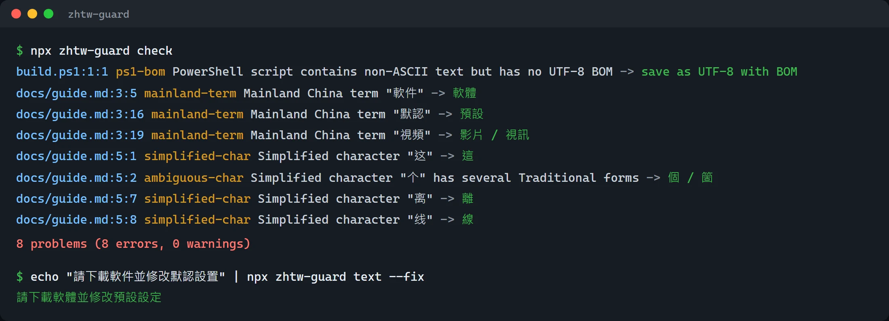

# zhtw-guard

Keep Traditional Chinese (Taiwan) text consistent in code, docs and AI output.

[繁體中文](#繁體中文) | [English](#english)

[](https://www.npmjs.com/package/zhtw-guard)



The design is in [docs/spec.md](docs/spec.md). Release notes are in [CHANGELOG.md](CHANGELOG.md).

---

## 繁體中文

`zhtw-guard` 是給台灣與使用繁體中文的開發者用的檢查工具。它會在你的專案、文件、提交訊息與 AI 代理的回覆裡，找出混進來的簡體字、中國大陸用語與編碼問題，並給出修正建議。

### 它要解決的問題

- 文件與介面字串混入簡體字，例如「设定」「软件」 <!-- zhtw-guard-ignore -->
- 字是繁體，但用語是中國大陸慣用，例如「軟件」應為「軟體」、「默認」應為「預設」 <!-- zhtw-guard-ignore -->
- Windows 上常見的編碼問題：cp950 亂碼、PowerShell 腳本缺少 UTF-8 BOM、混用 CRLF 與 LF
- AI 代理在工作途中把回覆切換成英文或簡體中文

### 安裝

需要 Node.js 22 以上版本。

```sh
npm install --save-dev zhtw-guard
```

也可以不安裝，直接用 `npx zhtw-guard` 執行。

### 使用方式

```sh
npx zhtw-guard check                  # 檢查目前資料夾
npx zhtw-guard check README.md docs   # 只檢查指定的檔案或資料夾
npx zhtw-guard fix                    # 自動修正可確定的問題，再回報其餘問題
echo "请安装软件" | npx zhtw-guard text          # 檢查標準輸入 zhtw-guard-ignore
echo "请安装软件" | npx zhtw-guard text --fix    # 輸出修正後的文字 zhtw-guard-ignore
```

每個問題一行，格式為 `路徑:行:欄 規則 說明 -> 建議`。

| 選項 | 說明 |
| --- | --- |
| `--format json` | 改用 JSON 輸出，方便給其他工具或 CI 使用 |
| `--format github` | 輸出 GitHub Actions 的 workflow commands，在檔案行上標註問題 |
| `--strictness <default\|strict>` | 覆寫設定檔的用語嚴格度 |
| `--fail-on <error\|warning>` | 設為 `warning` 時，警告也會讓結束代碼變成 `1` |
| `--config <檔案>` | 指定設定檔，不自動尋找 `zhtw-guard.config.json` |
| `--path <檔名>` | 只用於 `text`：指定檔名，讓 `ps1-bom` 這類依副檔名判斷的規則生效 |
| `--fix` | 只用於 `text`：輸出修正後的文字，剩下的問題寫到標準錯誤 |
| `--reply` | 只用於 `text`：把輸入當成 AI 代理的回覆，額外檢查第一句是不是繁體中文 |

結束代碼：`0` 沒有錯誤，`1` 發現錯誤，`2` 指令用法或設定檔有誤。設為 `warning` 的規則只會回報，除非加上 `--fail-on warning`，否則不會讓結束代碼變成 `1`。`hook` 指令的結束代碼另有約定，請見下方說明。

### 規則

| 規則 | 檢查內容 | 自動修正 |
| --- | --- | --- |
| `simplified-char` | 繁體文字中的簡體字 | 只有一對一對應時修正 |
| `mainland-term` | 中國大陸用語 | 只有一個建議用語時修正 |
| `ambiguous-char` | 有多個繁體寫法的簡體字，例如「发」可能是「發」或「髮」 | 不修正，只回報 | <!-- zhtw-guard-ignore -->
| `mojibake` | 疑似 cp950 或 UTF-8 解碼錯誤造成的亂碼 | 不修正，只回報 |
| `ps1-bom` | 含有非 ASCII 文字、但沒有 UTF-8 BOM 的 `.ps1` 檔案 | 加上 BOM |
| `line-ending` | 同一個檔案混用 CRLF 與 LF | 統一成較多的那一種 |
| `reply-language` | AI 代理回覆的第一句不是繁體中文（英文、簡體中文或日文）。只在 `text --reply` 與 `hook` 檢查回覆時啟用 | 不修正，只回報 |

`fix` 不會改寫不是有效 UTF-8 的檔案，以免損壞原本的內容。

### 設定檔

在專案根目錄放一個 `zhtw-guard.config.json`。工具會從目前資料夾往上層尋找，路徑規則都以設定檔所在的資料夾為準。

```json
{
  "include": ["**/*.md", "src/**"],
  "exclude": ["vendor/**"],
  "rules": {
    "mainland-term": "warning",
    "line-ending": "off"
  },
  "strictness": "default",
  "allow": ["某個產品名稱"],
  "extraTerms": {
    "質量": "品質",
    "渠道": ["通路", "管道"]
  }
}
```

- `include`、`exclude`：要檢查與略過的路徑規則，支援 `*`、`**`、`?` 與 `{a,b}`。`node_modules` 與 `.git` 一律略過。
- `rules`：把規則設為 `error`、`warning` 或 `off`。
- `strictness`：用語檢查的嚴格度，`default` 或 `strict`，說明見下一節。
- `allow`：不要回報的詞，例如引用的簡體原文或產品名稱。
- `extraTerms`：專案自己的用語對照。只有一個建議時，`fix` 會自動替換。

### 用語嚴格度

| 模式 | 檢查範圍 | 自動修正 |
| --- | --- | --- |
| `default`（預設） | 保守詞表 `data/tw-terms.json`，只收在台灣幾乎都不會這樣用的中國大陸用語，例如「軟件」「默認」 | 只有一個建議用語時修正 | <!-- zhtw-guard-ignore -->
| `strict` | 再加上 `data/tw-terms-strict.json`，檢查台灣軟體圈慣用的術語，例如「支持」改為「支援」、「對象」改為「物件」、「數據」改為「資料」、「消息」改為「訊息」，以及程式脈絡下的「程序」改為「程式」、指電腦檔案時的「文件」改為「檔案」 | 只修正不受上下文影響的詞，例如「發佈」改為「發布」；其餘只回報 |

`strict` 模式的詞在一般文章裡也可能是正確用法，例如「說明文件」「好消息」，所以大多只回報，請自行判斷是否修改。常見的正確用法已列為保護詞，不會被回報。

### 行內忽略

以 `zhtw-guard-ignore` 結尾的行不會被檢查。標記可以放在行尾註解裡：

```js
const sample = "简体示例"; // zhtw-guard-ignore
```

在 Markdown 裡可以寫成 `<!-- zhtw-guard-ignore -->`，畫面上不會顯示。

### GitHub Action

在 Pull Request 上只檢查有變更的檔案，並在問題所在的行加上標註。不是 Pull Request 的事件（例如推送到 main）會檢查 `paths` 指定的全部檔案。

```yaml
name: zhtw-guard

on: pull_request

permissions:
  contents: read

jobs:
  check:
    runs-on: ubuntu-latest
    steps:
      - uses: actions/checkout@v5
      - uses: zzoraemon043/zhtw-guard@v0.2.0
        with:
          paths: docs src README.md
          strictness: default
          fail-on: error
```

| 參數 | 說明 | 預設值 |
| --- | --- | --- |
| `paths` | 要檢查的檔案或資料夾，以空白或換行分隔。Pull Request 時只檢查其中有變更的檔案 | `.` |
| `strictness` | 用語嚴格度，`default` 或 `strict`。留空時依 `zhtw-guard.config.json` | 空白 |
| `fail-on` | `error` 只在有錯誤時失敗，`warning` 連警告也會失敗 | `error` |

這個 Action 會用 `actions/setup-node` 安裝 Node.js 22，並在 Action 的目錄裡建置 zhtw-guard。本倉庫的 [.github/workflows/zhtw-guard.yml](.github/workflows/zhtw-guard.yml) 就是用它檢查自己。

### AI 代理 hook

`zhtw-guard hook` 從標準輸入讀取 AI 代理的 hook 事件 JSON，檢查回覆文字或剛寫入的檔案。沒有問題時結束代碼為 `0` 且沒有輸出；有問題時結束代碼為 `2`，問題寫到標準錯誤，讓 AI 代理自行修正。欄位名稱可以用 `--text-field`、`--path-field` 設定。設定方式與範例請見 [docs/hooks.md](docs/hooks.md)。

要單獨檢查一段回覆，也可以用 `text --reply`，它會額外確認第一句是繁體中文：

```sh
echo "好的，我來修改。" | npx zhtw-guard text --reply
```

### 詞庫來源

字表與用語表以 [OpenCC](https://github.com/BYVoid/OpenCC)（Apache-2.0）的資料為基礎，授權檔與出處說明放在 [`data/`](data/README.md)。台灣用語表 `data/tw-terms.json` 由本專案維護，每一筆都有測試。

### 開發

```sh
npm ci
npm test
npm run lint
npm run build
node dist/cli/main.js check
```

貢獻規則請見 [AGENTS.md](AGENTS.md)。

### 授權

[MIT](LICENSE)。`data/opencc/` 內的 OpenCC 資料採用 Apache-2.0 授權。

---

## English

`zhtw-guard` is a checker for developers who write Traditional Chinese (Taiwan). It finds Simplified characters, Mainland China terms and encoding problems in your files, commit messages and AI agent output, and suggests fixes.

### Problems it targets

- Simplified characters mixed into docs and UI strings
- Traditional characters with Mainland vocabulary, for example 軟件 instead of 軟體 <!-- zhtw-guard-ignore -->
- Windows encoding issues: cp950 mojibake, PowerShell scripts without a UTF-8 BOM, mixed CRLF and LF
- AI agents that switch their replies to English or Simplified Chinese mid-task

### Install

Requires Node.js 22 or later.

```sh
npm install --save-dev zhtw-guard
```

You can also run it without installing through `npx zhtw-guard`.

### Usage

```sh
npx zhtw-guard check                  # check the current directory
npx zhtw-guard check README.md docs   # check only these files or directories
npx zhtw-guard fix                    # apply safe fixes, then report the rest
echo "请安装软件" | npx zhtw-guard text          # check standard input zhtw-guard-ignore
echo "请安装软件" | npx zhtw-guard text --fix    # print the fixed text zhtw-guard-ignore
```

Each problem is printed on one line as `path:line:column rule message -> suggestion`.

| Option | Description |
| --- | --- |
| `--format json` | Print JSON for other tools and CI |
| `--format github` | Print GitHub Actions workflow commands that annotate problem lines |
| `--strictness <default\|strict>` | Override the term strictness from the config file |
| `--fail-on <error\|warning>` | With `warning`, warnings also change the exit code to `1` |
| `--config <file>` | Use this config file instead of searching for `zhtw-guard.config.json` |
| `--path <name>` | `text` only: file name for rules that depend on it, such as `ps1-bom` |
| `--fix` | `text` only: print the fixed text and write remaining problems to standard error |
| `--reply` | `text` only: treat the input as an AI agent reply and also check that the first sentence is Traditional Chinese |

Exit codes: `0` no errors, `1` errors found, `2` usage or configuration error. Rules set to `warning` are reported but do not change the exit code to `1` unless you pass `--fail-on warning`. The `hook` command uses its own exit codes, described below.

### Rules

| Rule | What it finds | Auto fix |
| --- | --- | --- |
| `simplified-char` | Simplified characters in Traditional text | When the mapping is one to one |
| `mainland-term` | Mainland China vocabulary | When there is one suggested term |
| `ambiguous-char` | Simplified characters with several Traditional forms, for example 发 to 發 or 髮 | No, report only | <!-- zhtw-guard-ignore -->
| `mojibake` | Text that looks like cp950 or UTF-8 decoding damage | No, report only |
| `ps1-bom` | `.ps1` files with non-ASCII text and no UTF-8 BOM | Adds the BOM |
| `line-ending` | Mixed CRLF and LF in one file | Converts to the more common one |
| `reply-language` | An AI agent reply whose first sentence is not Traditional Chinese (English, Simplified Chinese or Japanese). Only runs for `text --reply` and for replies in `hook` | No, report only |

`fix` never rewrites a file that is not valid UTF-8, so the original bytes are not damaged.

### Configuration

Put a `zhtw-guard.config.json` at the project root. The tool searches from the current directory upward, and all patterns are relative to the directory of the config file.

```json
{
  "include": ["**/*.md", "src/**"],
  "exclude": ["vendor/**"],
  "rules": {
    "mainland-term": "warning",
    "line-ending": "off"
  },
  "strictness": "default",
  "allow": ["SomeProductName"],
  "extraTerms": {
    "質量": "品質",
    "渠道": ["通路", "管道"]
  }
}
```

- `include` and `exclude`: path patterns with `*`, `**`, `?` and `{a,b}`. `node_modules` and `.git` are always skipped.
- `rules`: set a rule to `error`, `warning` or `off`.
- `strictness`: how strict the term check is, `default` or `strict`. See the next section.
- `allow`: words that must not be flagged, for example quoted Simplified text or product names.
- `extraTerms`: project-specific replacements. `fix` applies a term automatically when it has one replacement.

### Term strictness

| Mode | What it checks | Auto fix |
| --- | --- | --- |
| `default` | The conservative table `data/tw-terms.json`, which only lists Mainland terms that are almost never right in Taiwan, such as 軟件 and 默認 | When there is one suggested term | <!-- zhtw-guard-ignore -->
| `strict` | Also `data/tw-terms-strict.json`, the terms Taiwan software teams prefer: 支持 to 支援, 對象 to 物件, 數據 to 資料, 消息 to 訊息, 程序 to 程式 in code, 文件 to 檔案 for computer files | Only terms that do not depend on context, such as 發佈 to 發布; the rest are reported only |

Words in the strict table can be correct in everyday writing, for example 說明文件 or 好消息, so most of them are reported but not fixed. Common correct phrases are protected and never reported.

### Inline ignore

A line that ends with `zhtw-guard-ignore` is skipped. The marker can sit inside a trailing comment:

```js
const sample = "简体示例"; // zhtw-guard-ignore
```

In Markdown, write `<!-- zhtw-guard-ignore -->` so the marker stays hidden.

### GitHub Action

On pull requests the action checks only the changed files and annotates the lines with problems. Other events, such as a push to main, check everything under `paths`.

```yaml
name: zhtw-guard

on: pull_request

permissions:
  contents: read

jobs:
  check:
    runs-on: ubuntu-latest
    steps:
      - uses: actions/checkout@v5
      - uses: zzoraemon043/zhtw-guard@v0.2.0
        with:
          paths: docs src README.md
          strictness: default
          fail-on: error
```

| Input | Description | Default |
| --- | --- | --- |
| `paths` | Files or directories to check, separated by spaces or new lines. On pull requests only changed files inside them are checked | `.` |
| `strictness` | Term strictness, `default` or `strict`. Leave empty to use `zhtw-guard.config.json` | empty |
| `fail-on` | `error` fails only on errors, `warning` fails on warnings too | `error` |

The action installs Node.js 22 with `actions/setup-node` and builds zhtw-guard in the action directory. This repository checks itself with it in [.github/workflows/zhtw-guard.yml](.github/workflows/zhtw-guard.yml).

### AI agent hooks

`zhtw-guard hook` reads a hook event from an AI agent as JSON on standard input and checks the reply text or the file that was just written. It exits with `0` and no output when clean, and with `2` and the problems on standard error when something is wrong, so the agent can fix it. Set the field names with `--text-field` and `--path-field`. See [docs/hooks.md](docs/hooks.md) for setup and examples.

To check a single reply, use `text --reply`, which also checks that the first sentence is Traditional Chinese:

```sh
echo "Sure, I will fix it." | npx zhtw-guard text --reply
```

### Dictionary data

The character and term tables start from [OpenCC](https://github.com/BYVoid/OpenCC) (Apache-2.0). Its license file and attribution are in [`data/`](data/README.md). The Taiwan term table `data/tw-terms.json` is maintained in this repository, and every entry has a test.

### Development

```sh
npm ci
npm test
npm run lint
npm run build
node dist/cli/main.js check
```

See [AGENTS.md](AGENTS.md) for contributor rules.

### License

[MIT](LICENSE). The OpenCC data in `data/opencc/` is licensed under Apache-2.0.
